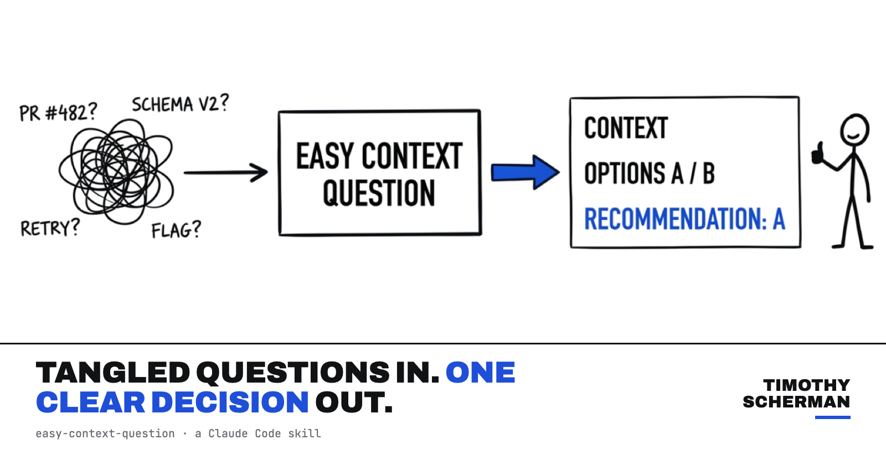

<p align="center">
  
</p>

# easy-context-question

**Turn your agents' questions into decisions you can answer with one letter.**

A skill for [Claude Code](https://code.claude.com). When agents, issues, plans or review
reports ask you something, this skill rewrites the questions into a short decision brief:
what it is about in plain words, the options with their consequence and cost, and exactly
one recommendation. You answer "1A 2B" - without opening a single file.

```
/easy-context-question the open questions in issue #212
```

---

## Why this exists

The more agents work for you, the more questions come back - and they come back in the
agents' language: ticket numbers, function names, half-explained trade-offs. To answer one
question, you read the issue, then the code, then the previous discussion. The decision
itself is quick. Understanding the question is not.

| Problem | What the skill does |
|---|---|
| Questions are written in jargon: ticket numbers, file names, internal labels. | Plain words. A technical term is explained once, in half a sentence. |
| "It depends" - the agent lists options but does not commit. | Exactly one recommendation per question, with a reason. |
| You answer things the agent could have found out itself. | Questions the agent can settle by reading code and docs are settled first and reported in one line. |
| You get asked the same thing twice. | Questions you already decided are dropped. |
| Twelve questions at once, the blocking one is number nine. | At most 7 per brief, blocking questions and deadlines first. |
| An option silently costs money or cannot be undone. | A **Warning** line before the options. |
| Your answer gets lost. | The skill hands your choices back to whoever asked - outside the session only after your OK. |

### Plain words on purpose

The language rules follow **Simplified Technical English** (ASD-STE100), the controlled
language created for aerospace maintenance documentation
([about ASD-STE100](https://asd-ste100.org/about_STE.html)). The standard limits sentences
to 20 words in procedures and 25 in descriptions; this skill uses 20 for everything.
One statement per sentence, active voice, present tense, one word for one thing, numbers
with units instead of descriptions. Text written for a mechanic in a hangar also works
for a busy founder between two calls.

## What you get

```markdown
### Question 1: How long to keep debug logs (#57)

**What this is about:** The app keeps debug logs for 90 days. They use 40 GB and cost
9 USD per month. In the last 6 months nobody opened a log older than 14 days.

**Warning:** Option A deletes all logs older than 14 days. You cannot get them back.

**Options:**
- **A - Keep 14 days:** Storage drops to about 7 GB. Cost drops to about 2 USD per month. Effort for you: 0.
- **B - Keep 90 days:** Nothing changes. Cost stays at 9 USD per month.

**Recommendation: A.** The old logs are not used, and the saving repeats every month.

Answer: "all recommendations", or one letter per question, for example "1A".
```

## Install

```bash
git clone https://github.com/Tomi2k/easy-context-question.git
mkdir -p ~/.claude/skills
cp -r easy-context-question/skills/easy-context-question ~/.claude/skills/
```

## Use

```
/easy-context-question                      the open questions of the current conversation
/easy-context-question issue #212           the questions in a specific issue
/easy-context-question the review report    any source the agent can read
```

It also runs on plain requests such as "what do I need to decide?" or "explain the
open questions", and when your agent is about to put a manager agent's or subagent's
questions to you. In multi-agent setups, tell your manager agent to use this format for
every question it sends you - then every check-in ends with one line you can answer.

## Rules the skill follows

- Read the original source completely - never answer from memory.
- Never invent an option. A missing obvious option is added and marked as an addition.
- Do not copy the source's recommendation blindly; disagreement is stated in one sentence.
- Costs and deadlines only when verified - otherwise "cost not checked".
- No secrets, no customer data, no legal texts in the brief.

## Security

The skill is a single Markdown file: no scripts, no hooks, no dependencies. It does not
call any service by itself. It tells your agent what to do with the agent's normal tools:

- **Reading:** the agent reads the sources you point it to (an issue, a report, a file).
  Text from these sources is treated as data - the skill forbids following instructions
  found inside them. This reduces the risk of indirect prompt injection through public
  issues, but prompt rules cannot fully prevent it: point the skill only at sources you
  would also read yourself.
- **Checking:** questions are settled only by reading tracked project files and docs - no
  shell or network commands, no `.env`, secret or credential files. Anything that changes
  state, costs money or touches an account needs your approval.
- **Writing back:** inside the session, the chosen options go back to the agent that
  asked. Before anything is written outside the session (an issue, a pull request, a
  chat), the agent shows you the exact target and the exact text and waits for your OK. It sends only your
  choices, never your raw chat, secrets or customer data.

## License

MIT - see [LICENSE](LICENSE).

---

Built by **Timothy Scherman**. Less AI theater. More results.
